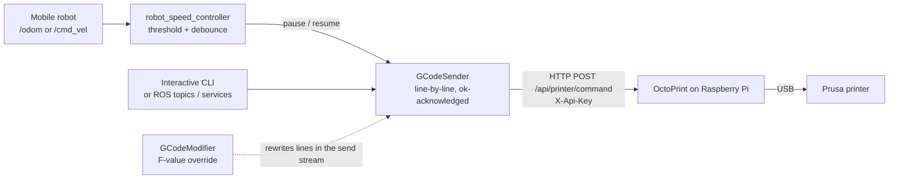

# ROS × OctoPrint: G-code Streaming with Precise Pause for Mobile 3D Printing

-22314E?logo=ros)


The **first-generation printer controller** for a mobile additive-manufacturing platform, where a 3D printer rides on a mobile robot and has to pause whenever the robot moves.
It streams G-code **one line at a time** to a Prusa printer through **OctoPrint's REST API** on a Raspberry Pi (OctoPi), and adds precise pause/resume, a pause-latency benchmark, robot-speed-based auto pause and real-time feed-rate override, all controllable from ROS.

> **Status:** archived research code (Sep–Dec 2025). Development moved to direct USB control with Printrun in [3dprinter_control_PRINTRUN](https://github.com/greenaandblue/3dprinter_control_PRINTRUN). That removes the HTTP round trip and allows line-level pause.

## Architecture



## Development timeline

| When | Module | What it adds |
|---|---|---|
| Sep 2025 | [`gcode_controller.py`](gcode_controller.py), [`enhanced_gcode_sender*.py`](enhanced_gcode_sender.py) | Send G-code lines through the OctoPrint API from Python; interactive mode, batching, buffered reading, bed-heating wait |
| Oct 2025 | [`accurate_pause_ver(last version).py`](<accurate_pause_ver(last version).py>) | **Precise pause system:** per-line `ok` confirmation, printer-level pause/resume, Z-lift + filament retract on pause, temperature hold, state save/restore |
| Sep–Oct 2025 | [`node示例/`](<node示例/>), [`gcode_controller_node/`](gcode_controller_node/) | ROS packaging: services `start_print`, `pause_print`, `resume_print`, `stop_print`, `set_speed`, `get_status`; messages `PrintStatus`, `PrintProgress`, `TemperatureInfo`; simple `/gcode_command` → `/printer_status` node |
| Oct–Nov 2025 | [`PausePerformanceTest/`](PausePerformanceTest/) | **Pause-latency benchmark:** pause at line N, at N %, or across files; repeats, mean / σ / min / max; JSON + CSV reports |
| Nov 2025 | [`RobotMotionBasedControl/`](RobotMotionBasedControl/) | **Motion-based control:** subscribe to robot speed (`/odom` or `/cmd_vel`), auto pause above a threshold and resume below it, debounce, CSV event log |
| Dec 2025 | [`SpeedOverride/`](SpeedOverride/), [`gcode_modifier.py`](gcode_modifier.py) | **Real-time feed-rate override:** rewrite `F` values in the send stream (percentage or fixed), handling modal feed rates, without touching the file; inject custom G-code while paused |

## Results: pause / resume timing

Measured with `PausePerformanceTest` on an 854-line file, pausing at four points with three repeats each. Times are the end-to-end duration of the `pause()` / `resume()` routines, including the API calls, the Z-lift / retract moves and fixed settling waits.

| Pause at | Pause mean ± σ | Resume mean ± σ |
|---|---|---|
| line 200 (23 %) | 1014 ± 35 ms | 2487 ± 221 ms |
| line 400 (47 %) | 1133 ± 130 ms | 2380 ± 53 ms |
| line 600 (70 %) | 1256 ± 386 ms | 2551 ± 327 ms |
| line 800 (94 %) | 1033 ± 37 ms | 2697 ± 308 ms |

Pause time shows no clear trend with position in the file (median ≈1.03 s), but it has noticeable outliers. That, plus an HTTP round trip for every line, motivated the switch to direct serial control.
Raw data: [`PausePerformanceTest/test_results/`](PausePerformanceTest/test_results/)

## Quick start

**Requirements:** a Raspberry Pi running OctoPrint (OctoPi) connected to the printer; Ubuntu + ROS 1 on the control PC; `pip install requests`.

1. In the OctoPrint web UI, open **Settings → API / Application Keys** and create a key.
2. Put the host and key in your local config: `OCTOPRINT_URL` / `API_KEY` near the bottom of the script you run, or the `~api_key` ROS parameter for the nodes. **Don't commit real keys.**
3. Run the module you need:

```bash
# Precise-pause sender with an interactive prompt
python3 "accurate_pause_ver(last version).py"
#   >>> file /path/to/part.gcode   >>> pause   >>> resume   >>> status   >>> stop

# Printing + automatic pause when the robot moves
cd RobotMotionBasedControl && python3 script1112.py
#   >>> print /path/to/part.gcode   >>> threshold 0.04   >>> debounce 0.5   >>> status

# Speed override + G-code injection while paused
cd SpeedOverride && python3 gcode_sender12.3.py
```

Test models (STL) and sliced G-code files of four sizes (1 min to 2 h 48 min) are in [`stl files/`](<stl files/>) and [`PausePerformanceTest/test_files/`](PausePerformanceTest/test_files/).

## Repository structure

```
├── accurate_pause_ver(last version).py   Precise-pause sender (latest OctoPrint version)
├── gcode_controller.py, enhanced_*.py    Early senders
├── gcode_modifier.py                     Feed-rate override module
├── gcode_controller_node/                Early ROS package (launch, config)
├── node示例/                              Full ROS package template: msg/, srv/, launch/, config/, test/
├── PausePerformanceTest/                 Latency benchmark framework, test G-code, results
├── RobotMotionBasedControl/              Speed-based auto pause + deployment/debug guides
├── SpeedOverride/                        Feed-rate override + G-code injection
├── config/printer_config.yaml            OctoPrint host, motion limits, G-code templates
├── demand_relevent/                      Requirements and stage plans (中文)
├── Notes/                                Usage notes (中文)
├── stl files/                            Test models
└── else/                                 Early tests and OctoPrint screenshots
```

## Related repositories

| Repo | Role |
|---|---|
| [3dprinter_control_PRINTRUN](https://github.com/greenaandblue/3dprinter_control_PRINTRUN) | Next generation: ROS + Printrun over USB, line-level pause, override / inject |
| [Octoprint](https://github.com/greenaandblue/Octoprint) | OctoPi setup and ROS packaging notes |
| [KUKA-printer_munual](https://github.com/greenaandblue/KUKA-printer_munual) | Lab manual for the KUKA + printer setup |

## Author

**Huihang Liu** · Computer Engineering, Penn State · [@greenaandblue](https://github.com/greenaandblue)
